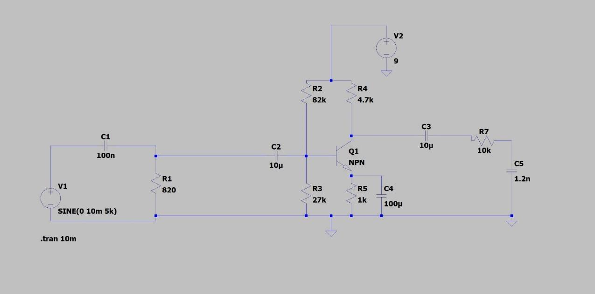
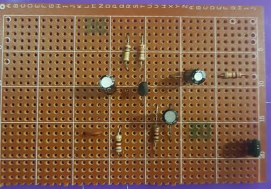
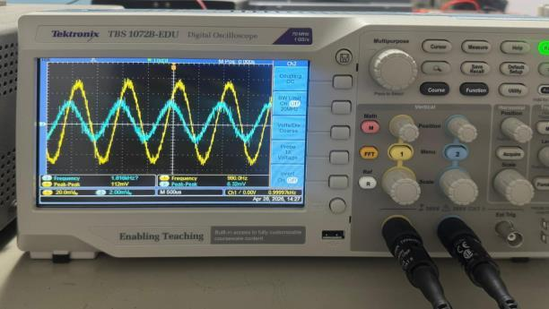
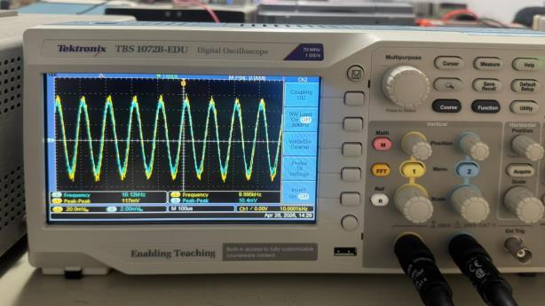
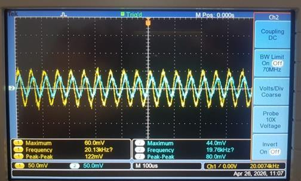
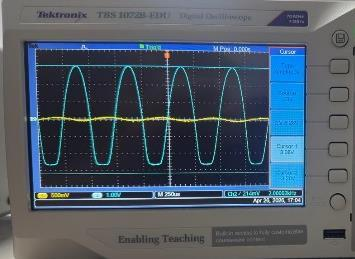
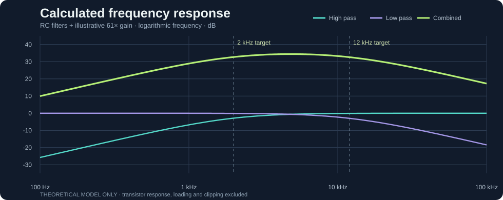

# SignalForge

### Multi-Stage Analog Signal Conditioning Circuit

**A design record and interactive frequency-response model for the IE2034 Analog Electronics Group 03 assignment.**

This repository presents a dot-board analog signal conditioner intended for a basic AM radio audio output. It pairs the reported hardware design and selected original report images with a browser-based, first-order RC model. The model is intentionally identified as theoretical; it does not reproduce measured oscilloscope traces or simulate the BJT transistor.

## Project at a glance

| Design target | Reported implementation |
| --- | --- |
| Reject low-frequency interference below 2 kHz | 820 Ω + 100 nF high-pass network; calculated corner ≈1.94 kHz |
| Raise weak signal amplitude by at least 60× | 2N3904 common-emitter stage; ~70× stage gain and ~61× full-path gain reported |
| Reduce high-frequency noise beyond 12 kHz | 1.2 nF output low-pass network; 10 kΩ shown in schematic, 11 kΩ used in report calculation |
| Operate from a 9 V DC supply | Divider-biased transistor stage on a soldered dot board |

## Visual record

The images below are extracted from the supplied final report. They show the reported circuit and prototype; they are not newly generated measurements.



*Complete circuit schematic, report p. 8. The output resistor is marked 10 kΩ here; the design calculation uses 11 kΩ.*



*Soldered dot-board prototype, report p. 11.*

## Oscilloscope captures

These four captures from the report stay visible in the README. The labels follow the report's figure captions; they are separate from the calculated graphic below.

| High-pass: 1 kHz | High-pass: 10 kHz |
| --- | --- |
|  |  |

| Low-pass: 20 kHz | Complete path: 7 kHz |
| --- | --- |
|  |  |

## Frequency response, in brief



*Static, first-order RC model shown directly in the README. The combined curve uses an illustrative constant 61× gain; it is not an oscilloscope trace or a transistor simulation.*

## Signal chain

```text
Input → 820 Ω / 100 nF high pass → 2N3904 common-emitter amplifier → 11 kΩ / 1.2 nF low pass → Output
             ≈ 1.94 kHz                 9 V supply; ≥60× target                 ≈ 12.06 kHz
```

The assignment targets a 2 kHz high-pass edge, a mid-band gain of at least 60, a 12 kHz low-pass edge and a 9 V supply. The report describes a dot-board prototype and observations at several test frequencies. Details and source inconsistencies are recorded in [engineering notes](docs/engineering-notes.md).

## What is in this repository

| Path | Purpose |
| --- | --- |
| `index.html` | Project page, hardware gallery and interactive response explorer |
| `docs/assets/` | Selected schematic, prototype and oscilloscope images extracted from the supplied report |
| `src/model.js` | Dependency-free RC calculations |
| `src/app.js` | Canvas visualization and controls |
| `src/model.test.js` | Numerical checks using Node's test runner |
| `scripts/render-response.js` | Generates the small README response graphic from the same JS model |
| `docs/engineering-notes.md` | Component record, calculations and open verification items |

## For contributors

The project page is also available in `index.html`, with an interactive response explorer and the same hardware gallery. Run `npm start` with Node.js 18 or later to preview it locally. Run `npm run render:response` after changing model values, then `npm test`. The README above remains readable on GitHub without running anything.

## Model boundaries

The chart multiplies ideal first-order high-pass and low-pass magnitudes by a selectable, constant gain. It omits loading, coupling-capacitor response, BJT bias and small-signal behaviour, supply-limited clipping, component tolerances and measurement uncertainty. Its curves are useful for exploring the intended band, not for validating the assembled hardware.

## Provenance

Based on the supplied **IE2034 Final Assignment** brief and **Group No. 03 Analog Electronics Final Report** (2026). The original PDFs are not redistributed here. Six images in `docs/assets/` are reproduced from the report and labelled by report page. Original CAD files and numeric oscilloscope exports can be added when available.

## Project team

Group 03, IE2034 Analog Electronics (2026). Individual credits can be added with the team's approval.
